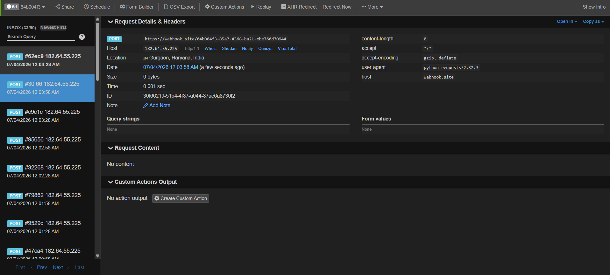
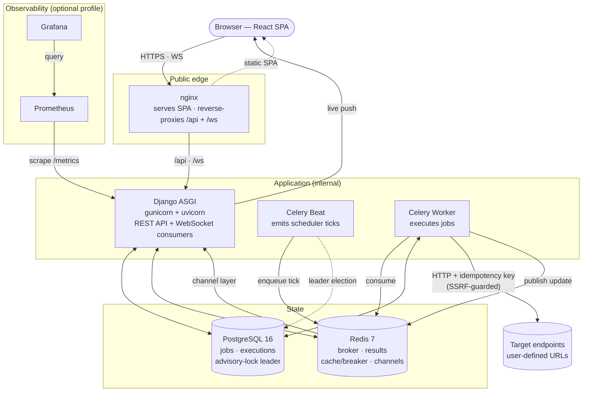

# chronoq

A distributed HTTP job scheduler — define a job once (a URL, a method, a cron
schedule), and chronoq fires it reliably, forever, with at-least-once delivery,
automatic retries, a per-domain circuit breaker, and a live execution feed.

Built as a deep-dive into the distributed-systems patterns behind production
schedulers — leader election, idempotency, backpressure, and observability —
running end to end under Docker Compose.

<!-- Replace Nishant96089/chronoq with your GitHub path -->

[](https://github.com/Nishant96089/chronoq/actions/workflows/ci.yml)



---

## What it does

- **Schedule** any HTTP call on a cron expression, with per-job timeout, headers,
  body, and retry policy.
- **Fire reliably** — a single elected leader dispatches due jobs; workers execute
  them with at-least-once delivery and a stable idempotency key so receivers can
  dedupe.
- **Fail gracefully** — exponential-backoff retries, and a per-domain circuit
  breaker that trips after repeated failures so one dead endpoint can't drown the
  worker pool.
- **Watch it live** — the job detail page streams execution status over a
  WebSocket as runs happen, no polling.
- **Operate it** — Prometheus metrics, Grafana dashboards, health/readiness
  probes, execution retention, API rate limiting, and encrypted secrets at rest.

---

## Architecture



**The flow:** Celery Beat ticks on a short interval, but only the node holding a
Postgres advisory lock actually schedules — that's the leader election, and it's
what makes it safe to run multiple scheduler nodes without double-firing. The
leader writes a `JobExecution` row and enqueues it; a worker picks it up, checks
the circuit breaker, makes the HTTP call (re-validating the target against the
SSRF guard right before the request), records the result, and publishes an update
onto the Redis channel layer. A Django Channels consumer relays that to the
browser over a WebSocket. Executions are append-only — retries create new rows
linked to the original.

---

## Key engineering decisions

Each of these is written up in [`docs/decisions.md`](docs/decisions.md); the
short version:

- **Leader election via Postgres advisory locks.** No extra coordination service
  (ZooKeeper/etcd). A `pg_advisory_lock` held for the duration of a tick means
  exactly one scheduler dispatches, and the lock auto-releases if that node dies.
- **At-least-once + idempotency.** `acks_late` + `reject_on_worker_lost` guarantee
  a job isn't silently dropped when a worker is killed mid-flight; a stable
  `X-Job-Execution-Id` header lets receivers dedupe the rare double-delivery.
- **Per-domain circuit breaker (Redis-backed).** Shared across all workers, so one
  worker discovering an outage protects the rest. Closed → open → half-open with a
  single-probe lock.
- **Retries with absolute, jittered backoff.** Retry time is computed from the
  _root_ execution's scheduled time, so backoff is deterministic regardless of
  when a worker happens to pick the job up; scheduler dispatch is jittered to
  avoid a thundering herd when many jobs share a cron minute.
- **Secrets at rest.** Job headers and body are encrypted with Fernet
  (`MultiFernet` for key rotation) — ciphertext in the database, plaintext only in
  the worker at call time.
- **SSRF protection.** A job's target URL is rejected if it resolves to a private,
  loopback, or link-local (cloud-metadata) address — enforced at create time and
  re-checked at execution to defeat DNS rebinding.
- **Reproducible builds.** Dependencies are fully pinned via `pip-tools`
  (`requirements.in` → locked `requirements.txt`), so a rebuild can't drift.

---

## Tech stack

| Layer         | Choice                                                      |
| ------------- | ----------------------------------------------------------- |
| API           | Django 5.1 · Django REST Framework · Django Channels (ASGI) |
| Workers       | Celery 5.4 (Beat + Worker)                                  |
| Serving       | gunicorn + uvicorn workers · nginx edge · WhiteNoise static |
| State         | PostgreSQL 16 · Redis 7                                     |
| Frontend      | React 19 · Vite · Tailwind · TanStack Query · React Router  |
| Observability | Prometheus · Grafana                                        |
| Tooling       | Docker Compose · ruff · black · pytest · GitHub Actions     |

---

## Quickstart (development)

```bash
git clone https://github.com/Nishant96089/chronoq.git chronoq
cd chronoq
cp .env.example .env            # then set DJANGO_SECRET_KEY + DJANGO_SUPERUSER_PASSWORD
make up                         # start all services (detached)
```

- Frontend: **http://localhost:3000**
- API: **http://localhost:8000/api/**
- Admin: **http://localhost:8000/admin/** (a superuser is auto-created from `.env`)

Common commands (`make help` lists them all):

```bash
make logs            # tail everything
make check           # ruff + black --check + pytest  (what CI runs)
make format          # black + ruff --fix + black
make shell-django    # Django shell
make down            # stop
make clean           # stop + wipe volumes
```

---

## Production

A separate, hardened compose stack: nginx is the only public port, Django runs
internal-only under gunicorn+uvicorn as a non-root user, migrations run once via a
dedicated job, and TLS terminates at the edge.

```bash
cp .env.prod.example .env.prod   # fill in real secrets
docker compose -f docker-compose.prod.yml --env-file .env.prod up -d --build
```

- Everything is served from **http://localhost** (nginx).
- On first boot, an initial admin is seeded from `DJANGO_SUPERUSER_*` **only if the
  user table is empty** — so a fresh deployment is immediately usable.
- Self-service registration is **off by default**; set `ENABLE_REGISTRATION=True`
  to expose `/api/auth/register/` and the "Create account" UI.

---

## Observability

```bash
docker compose --profile observability up -d
```

- Prometheus: **http://localhost:9090** (scrapes Django's `/metrics`, which
  aggregates across all worker processes via multiprocess mode)
- Grafana: **http://localhost:3001**

<!-- Capture a dashboard shot into docs/screenshots/dashboard.png and uncomment:

-->

Metrics include scheduler ticks (by leader/non-leader), executions by status,
retries, circuit-breaker trips by domain, and execution-duration histograms.

---

## Testing

```bash
make check     # 121 tests + lint + format check, exactly what CI enforces
```

Tests cover the scheduler, leader election, idempotency/redelivery, the circuit
breaker, retry backoff, jitter, retention, throttling, encryption, the SSRF
guard, registration, and the WebSocket consumers. CI (GitHub Actions) runs the
backend suite against real Postgres + Redis services and builds the frontend.

---

## Project layout

```
backend/
  chronoq/            # settings (base/dev/prod), asgi, urls, health, gunicorn.conf
  jobs/               # the app: models, services, tasks, circuit_breaker,
                      # realtime, consumers, validators (SSRF), registration, ...
  requirements*.in    # direct deps  →  requirements*.txt (pip-tools lock)
frontend/             # React SPA (Vite) + nginx prod image
infra/                # Postgres init
prometheus/ grafana/  # observability config
loadtest/             # k6 scenarios
docs/
  decisions.md        # architecture decision log
  idempotency.md      # delivery-semantics deep dive
docker-compose.yml          # dev
docker-compose.prod.yml     # production (nginx edge, internal services)
docker-compose.loadtest.yml # load testing
```

---

## Further reading

- [`docs/decisions.md`](docs/decisions.md) — the full decision log, written to be
  defensible in a senior-backend interview.
- [`docs/idempotency.md`](docs/idempotency.md) — delivery semantics in depth.

---

## Status & roadmap

Core system complete and load-tested under Docker Compose. Next: live public
deploy, container image publishing + deploy-on-merge, and a hardening pass
(including per-client throttling behind the proxy via `X-Forwarded-For` trust).

## License

MIT
